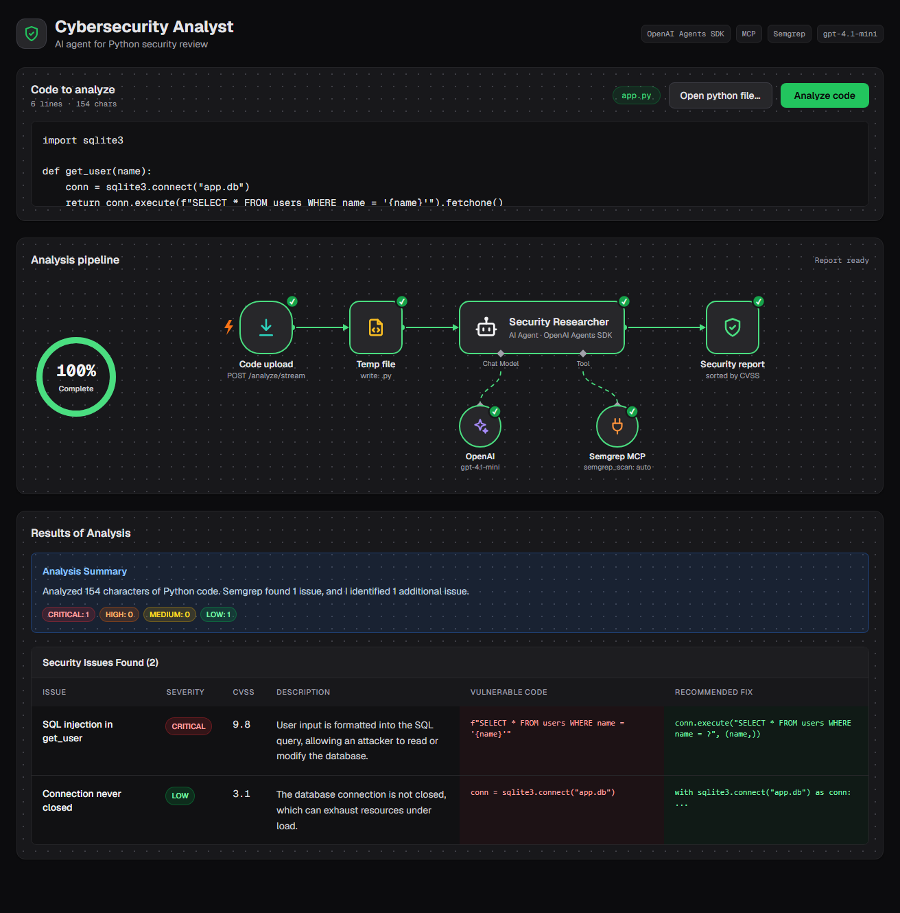
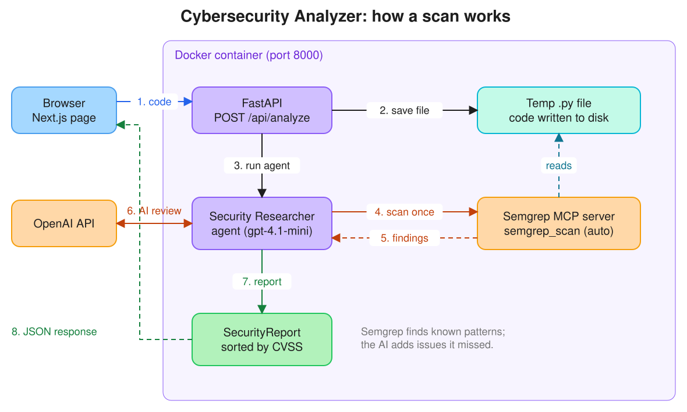
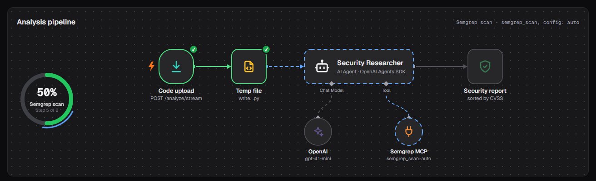

# Cybersecurity Analyzer

**An AI agent that reviews Python code for security vulnerabilities and explains how to fix them.**



<sub>Example output on a small sample file.</sub>

## Project Overview

Security reviews are slow and need specialist knowledge. This project automates the first pass. A user uploads a Python file in the browser, and within about two minutes an AI agent returns a security report. Each issue gets a severity score (CVSS 0–10), an explanation of the risk, the vulnerable code, and a suggested fix, with the most severe issues first. While it runs, a live pipeline view shows each step of the agent's work as it happens.

It combines two approaches:
- **Rule-based scanning** with Semgrep, an industry-standard security tool that reliably catches known vulnerability patterns.
- **AI reasoning** with an OpenAI model, which reviews the code like a security researcher and finds issues fixed rules miss.

It's a full-stack application with a web frontend and an API backend, packaged in Docker so it runs with a single command.

### AI Technologies

| Technology | What it is | How it's used here |
| --- | --- | --- |
| **AI Agents** | An LLM that decides which tools to call and acts on the results, rather than only answering text | A "Security Researcher" agent plans the review, runs the scanner, interprets the findings and writes the report |
| **OpenAI Agents SDK** | OpenAI's framework for building agents with tools, structured outputs and tracing | Runs the agent loop, connects it to tools, and traces each run |
| **MCP (Model Context Protocol)** | An open standard for connecting AI models to external tools and data | The agent reaches Semgrep through its MCP server, the same pattern used to plug any tool into an AI system |
| **Structured outputs** | Forcing the LLM to return data in a fixed schema instead of free text | Results are validated against a Pydantic model (`SecurityReport`), so the frontend always gets reliable JSON |
| **Prompt engineering** | Designing instructions that control the model's behavior | Instructions limit the agent to one scan, fix its configuration, and stop it repeating findings |
| **Streaming agent events** | Reading an agent's actions (tool calls, tool results) as they happen | `Runner.run_streamed` events drive the live progress view over Server-Sent Events |
| **Hybrid AI + static analysis** | Combining deterministic tools with LLM reasoning | Semgrep provides grounded facts; the LLM adds context and catches logic flaws |

### Skills Demonstrated

- **AI engineering**: agentic workflows, MCP tool integration, structured LLM output, prompt design
- **Backend**: Python 3.12, FastAPI, REST API design, Server-Sent Events streaming, async generators, Pydantic data validation
- **Frontend**: Next.js, React, TypeScript, Tailwind CSS, dark design system, streaming `fetch` reader, animated SVG components
- **DevOps**: Docker multi-stage builds, Docker Compose, environment-based configuration, secrets kept out of code
- **Security**: vulnerability analysis, CVSS scoring, the OWASP Top 10 and AI-specific risks (prompt injection, unsafe model loading)

---

## Architecture



1. `POST /api/analyze/stream` receives the source code (the UI uses this; `/api/analyze` returns the same report in one response).
2. Code is written to a temp `.py` file.
3. FastAPI runs the `Security Researcher` agent (`gpt-4.1-mini`).
4. Agent calls `semgrep_scan` (`config: auto`) once via the Semgrep MCP server (stdio).
5. Semgrep returns findings.
6. Agent reviews the code with OpenAI and adds issues Semgrep missed.
7. Output is parsed into `SecurityReport`; issues sorted by `cvss_score` (desc).
8. Report returned as the final stream event; temp file deleted.

Each step emits a progress event, so the UI shows the run live (see [Live pipeline UI](#live-pipeline-ui)).

| Layer | Stack |
| --- | --- |
| Frontend | Next.js, React, TypeScript, Tailwind (static export) |
| Backend | FastAPI, Python 3.12, `openai-agents`, `mcp==1.12.2`, `semgrep` |
| Runtime | Single Docker container, port `8000` (API + static files) |

Diagram source: [docs/flow.excalidraw](docs/flow.excalidraw)

## User Interface

A single-page dark UI. All panels share one theme (`.panel`: dark surface with a dotted grid), matching the pipeline graph.

| Area | What it shows |
| --- | --- |
| Header | App name and tech tags: OpenAI Agents SDK, MCP, Semgrep, `gpt-4.1-mini` |
| Code to analyze | File picker (`.py` only), file name chip, line / character count, read-only code view, **Analyze code** button with spinner |
| Analysis pipeline | Live node graph of the agent run (below) |
| Results | Summary with per-severity counts, issues table (severity badge, CVSS, description, vulnerable code in red, fix in green), skeleton rows while analyzing |

Theme tokens (in `globals.css`):

| Token | Value | Use |
| --- | --- | --- |
| `--background` | `#0c0c0e` | Page |
| `--surface` / `--surface-2` | `#18181b` / `#27272a` | Panels / nodes, buttons |
| `--foreground` / `--muted` | `#e4e4e7` / `#a1a1aa` | Text |
| `--primary` | `#22c55e` | Actions, success |
| `--info` | `#60a5fa` | Running / flowing |

### Live pipeline UI



While an analysis runs, the page draws the pipeline as a live node graph on a dark canvas. It is driven by real events from the agent run, not by a timer.

- **Main flow** (left → right): Code upload → Temp file → **Security Researcher** agent → Security report. Solid connectors with output dots and arrowheads.
- **Agent ports**: the agent node has **Chat Model** and **Tool** ports, connected by dashed curves to sub-nodes for **OpenAI** (`gpt-4.1-mini`) and **Semgrep MCP** (`semgrep_scan`).
- **Nodes**: each has its own icon. A running node gets an animated dashed outline; finished nodes show a ✓ / ✕ / – badge.
- **Progress ring**: percent complete, current step, and "Step X of 8".

| Connector | Meaning |
| --- | --- |
| Gray | Waiting |
| Blue dashed, animated | Data flowing into the running node |
| Green | Done |
| Red dashed | The next node failed |

The 8 stream steps map onto the graph nodes:

| Step | Emitted when |
| --- | --- |
| `received`, `saved` | Request accepted; temp file written |
| `mcp` | Semgrep MCP server starting / connected |
| `agent` | Agent run starts (`Runner.run_streamed`) |
| `scan` | `tool_called` event for `semgrep_scan` |
| `findings` | `tool_output` event (Semgrep results back) |
| `review` | Agent reasons over the findings with OpenAI |
| `report` | Output parsed to `SecurityReport` and sorted |

| Node | Steps |
| --- | --- |
| Code upload | `received` |
| Temp file | `saved` |
| Security Researcher | `mcp`, `agent`, `scan`, `findings`, `review` |
| Semgrep MCP (Tool) | `mcp`, `scan`, `findings` |
| OpenAI (Chat Model) | `agent`, `review` |
| Security report | `report` |

If the agent answers without calling Semgrep, the Semgrep node is shown as **Skipped**. On narrow screens the graph scrolls horizontally.

## API

| Method | Path | Request | Response |
| --- | --- | --- | --- |
| `POST` | `/api/analyze` | `{"code": str}` | `SecurityReport` |
| `POST` | `/api/analyze/stream` | `{"code": str}` | Server-Sent Events: step progress, then `result` |
| `GET` | `/health` | – | `{"message": str}` |

```ts
SecurityReport = { summary: string, issues: SecurityIssue[] }
SecurityIssue  = {
  title: string, description: string, code: string, fix: string,
  cvss_score: number,                              // 0.0–10.0
  severity: "critical" | "high" | "medium" | "low"
}
```

Stream events (`data: <json>` per event):

```ts
{ type: "step", id: StepId, status: "active" | "done" | "skipped" }
{ type: "result", report: SecurityReport }
{ type: "error", message: string }
// StepId: received → saved → mcp → agent → scan → findings → review → report
```

Errors: `400` empty code · `500` missing `OPENAI_API_KEY` or analysis failure.

```bash
curl -X POST http://localhost:8000/api/analyze \
  -H "Content-Type: application/json" \
  -d '{"code": "import os\nos.system(input())"}'
```

## Configuration

`.env` in the project root:

```
OPENAI_API_KEY=sk-proj-...
SEMGREP_APP_TOKEN=...
```

| Variable | Source |
| --- | --- |
| `OPENAI_API_KEY` | platform.openai.com/api-keys |
| `SEMGREP_APP_TOKEN` | semgrep.dev → Settings → Tokens (scope: `Agent (CI)`) |
| `ENVIRONMENT` | Set to `production` by `compose.yaml` (enables wildcard CORS) |

## Run

**Docker Compose**

```bash
docker compose up --build    # http://localhost:8000
docker compose down
```

**Development**

```bash
cd backend && uv run server.py    # :8000
cd frontend && npm install && npm run dev    # :3000
```

Requirements: Docker with ≥ 2 GB memory (Semgrep), or Node.js 20+ and `uv`.

Test inputs: [samples/](samples/)

## Project structure

```
cyber/
├── backend/                      # Python API + AI agent
│   ├── server.py                 # FastAPI app: /api/analyze, /api/analyze/stream, /health, static files
│   ├── context.py                # Agent system prompt and analysis prompt
│   ├── mcp_servers.py            # Semgrep MCP server (stdio) config and tool filter
│   └── pyproject.toml            # Dependencies (uv)
│
├── frontend/                     # Next.js web UI (static export)
│   ├── src/app/
│   │   ├── page.tsx              # Main page: upload → stream progress → results
│   │   ├── layout.tsx            # Root layout and fonts
│   │   └── globals.css           # Dark theme tokens, .panel style, flow-dash animation
│   ├── src/components/
│   │   ├── FileUpload.tsx        # .py file picker, Analyze button with spinner
│   │   ├── CodeInput.tsx         # Read-only code view with line/char count
│   │   ├── AnalysisProgress.tsx  # Live node graph: ring, nodes, ports, dashed connectors
│   │   ├── StepIcons.tsx         # SVG icons for the graph nodes
│   │   └── AnalysisResults.tsx   # Summary, severity counts, issues table, loading skeleton
│   ├── src/types/security.ts     # SecurityReport / SecurityIssue types
│   └── next.config.ts            # output: 'export'
│
├── samples/                      # Vulnerable Python files for testing
├── docs/                         # Architecture diagram (SVG + Excalidraw source), UI screenshot
│
├── Dockerfile                    # Stage 1: build frontend (Node 20) → Stage 2: Python 3.12 runtime
├── compose.yaml                  # One-command local run
└── .env                          # API keys (git-ignored, not committed)
```

| Layer | Entry point | Responsibility |
| --- | --- | --- |
| API | `backend/server.py` | Validates input, runs the agent, returns `SecurityReport` |
| Agent | `backend/context.py` | Defines how the AI reviews code |
| Tools | `backend/mcp_servers.py` | Connects the agent to Semgrep through MCP |
| UI | `frontend/src/app/page.tsx` | Upload, read the event stream, display results |
| Progress | `frontend/src/components/AnalysisProgress.tsx` | Renders step events as a live flow |

## Troubleshooting

| Error | Cause |
| --- | --- |
| `failed to connect to the docker API` | Docker Desktop not running |
| `401 invalid_api_key` | Invalid or revoked OpenAI key |
| `OpenAI API key not configured` | `.env` missing |
| Exit code `-9` during scan | Out of memory (< 2 GB) |
| Semgrep timeout on first run | Rules downloading; retry |
| `Pro Engine not installed` warning | Expected; ignore |

## Notes

- `mcp` pinned to `1.12.2` for compatibility with the Semgrep MCP server.
- Upload accepts `.py` only.
- AI findings may be incomplete or wrong.
